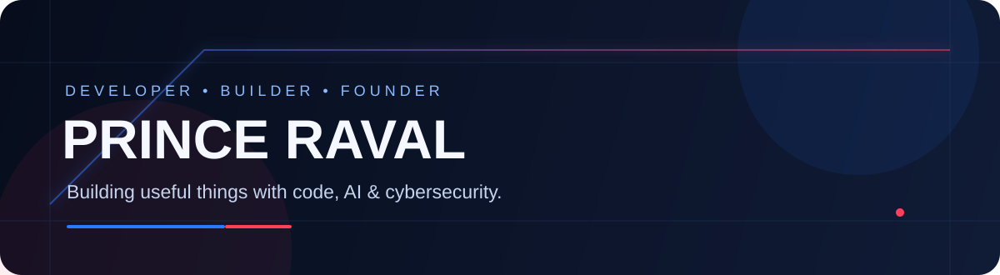

 

### B.Tech Cyber Security Student · Full-Stack & Mobile Developer · AI Enthusiast

---

## 👋 Hey, I'm Prince

I'm a B.Tech Cyber Security student at the **Institute of Advanced Research (IAR)**. I design and build end-to-end digital solutions—ranging from secure full-stack web platforms and cross-platform mobile apps to cybersecurity labs and intelligent tools.

- 🚀 **Building Products**: Developing real-world applications including **GearGuard** (enterprise maintenance tracking), **VentureX** (startup & investor ecosystem), and **SonicForge** (AI music & audio platform).
- 🛡️ **Cyber Security & Defense**: Exploring web security, ethical hacking, vulnerability labs (IDOR research), and mobile cryptographic primitives (**Cyber Garuda**).
- 💻 **Full-Stack & Mobile**: Crafting modern, reactive UIs with React, React Native, and Tailwind CSS, backed by resilient APIs built with Node.js, Express, FastAPI, PostgreSQL, and Prisma ORM.
- 🧠 **AI & Emerging Tech**: Experimenting with machine learning pipelines, automation models, and intelligent backend workflows.

---

## ⚡ Tech Stack & Skills

### 💻 Programming Languages

### 🎨 Frontend & Mobile Development

### ⚙️ Backend & API Engineering

### 🗄️ Databases & ORM

### 🛡️ Cybersecurity & Secure Architecture

-0A1F44?style=for-the-badge&logo=target&logoColor=FF354F)

### ☁️ DevOps, Cloud & Tools

-0A1F44?style=for-the-badge&logo=amazonwebservices&logoColor=FF9900)

---

## 🚀 Featured Projects

<table>
  <tr>
    <td width="50%" valign="top">
      <h3>🛡️ <a href="https://github.com/PrinceRaval1706/GearGuard-The-Ultimate-Maintenance-Tracker">GearGuard</a></h3>
      
<strong>The Ultimate Maintenance Tracker</strong>

      
A full-stack enterprise maintenance tracking platform with schedule management, analytics, and service history.

      
<code>TypeScript</code> · <code>React</code> · <code>Tailwind CSS</code> · <code>Node.js</code> · <code>Express</code> · <code>PostgreSQL</code> · <code>TanStack Query</code>

    </td>
    <td width="50%" valign="top">
      <h3>💼 <a href="https://github.com/PrinceRaval1706/VENTUREX">VENTUREX</a></h3>
      
<strong>Startup & Investor Ecosystem Platform</strong>

      
Full-stack mobile and backend application facilitating startup networking, pitch tracking, and real-time interaction.

      
<code>React Native</code> · <code>TypeScript</code> · <code>Redux Toolkit</code> · <code>Socket.io</code> · <code>Prisma ORM</code> · <code>Docker</code>

    </td>
  </tr>
  <tr>
    <td width="50%" valign="top">
      <h3>🦅 <a href="https://github.com/PrinceRaval1706">Cyber Garuda</a></h3>
      
<strong>Mobile Cyber Defense Application</strong>

      
Cross-platform mobile application integrating cryptographic algorithms, elliptic curves, and QR security validation.

      
<code>React Native</code> · <code>TypeScript</code> · <code>@noble/curves</code> · <code>Cryptography</code> · <code>Android/iOS</code>

    </td>
    <td width="50%" valign="top">
      <h3>🎵 <a href="https://github.com/PrinceRaval1706">SonicForge (Beatz AI)</a></h3>
      
<strong>Intelligent Audio Generation Platform</strong>

      
Scalable backend service powered by machine learning pipelines, structured validation, rate limiting, and containerized deployment.

      
<code>Node.js</code> · <code>TypeScript</code> · <code>Express</code> · <code>Zod</code> · <code>Docker</code> · <code>Python/ML</code>

    </td>
  </tr>
  <tr>
    <td width="50%" valign="top">
      <h3>🧠 <a href="https://github.com/PrinceRaval1706/thinking-data-">thinking-data-</a></h3>
      
<strong>Data Intelligence & Analytics System</strong>

      
High-throughput asynchronous backend service and analytical dashboard for structured data processing and cloud storage.

      
<code>FastAPI</code> · <code>Python</code> · <code>Motor (MongoDB)</code> · <code>Pydantic</code> · <code>AWS Boto3</code> · <code>React</code>

    </td>
    <td width="50%" valign="top">
      <h3>🔬 <a href="https://github.com/PrinceRaval1706/idor">IDOR Security Lab</a></h3>
      
<strong>Vulnerability Research & Defense</strong>

      
Hands-on cyber security testing environment demonstrating Insecure Direct Object References and modern authorization defenses.

      
<code>Node.js</code> · <code>Express</code> · <code>Cyber Security</code> · <code>Access Control</code> · <code>OWASP</code>

    </td>
  </tr>
</table>

---

## 📊 GitHub Analytics & Language Statistics

 

<table>
  <tr>
    <td align="center" width="54%">
      
    </td>
    <td align="center" width="46%">
      
    </td>
  </tr>
</table>

 

---

## 🤝 Let's Connect

I'm always open to discussing new startup ideas, engineering challenges, open-source collaborations, or cybersecurity research.

---

  Designed with a Midnight Royal Tech aesthetic · Deep navy · Electric blue · Crimson accents

