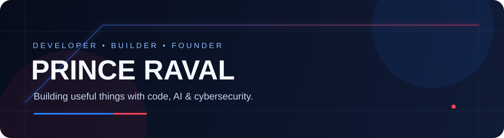

 

### B.Tech Cyber Security Student · Developer · AI Enthusiast · Entrepreneur

---

## 👋 Hey, I'm Prince

I'm a third-year B.Tech Cyber Security student at the **Institute of Advanced Research (IAR)**. I enjoy turning ideas into working products, exploring emerging technology, and building projects that solve practical problems.

- 🚀 Interested in building startups and useful digital products.
- 🧠 Exploring AI/ML, cybersecurity, and intelligent applications.
- 💻 Working across frontend, backend, and mobile development.
- 🛠️ Building and experimenting with projects across different domains.

## ⚡ Tech Stack

---

## 📊 GitHub Analytics & Language Statistics

 

<table>
  <tr>
    <td align="center" width="54%">
      
    </td>
    <td align="center" width="46%">
      
    </td>
  </tr>
</table>

 

 

---

## 🤝 Let's Connect

I'm always interested in meeting people who enjoy building, learning, and solving meaningful problems.

---

  Designed with a Royal Tech aesthetic · Deep navy · Electric blue · Crimson accents

